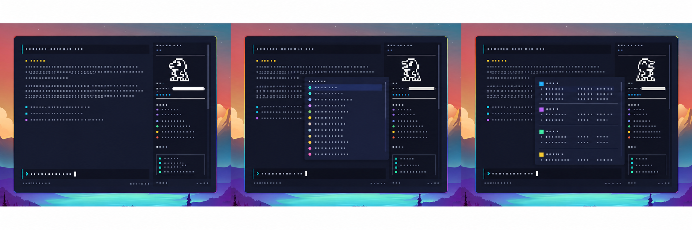

  
  <h1>Digital Pet</h1>
  
Raise a Digimon while you work, or take your companion with you in the browser.

Hatch an egg, watch your partner evolve, and discover 650 Digimon. Keep your past
companions in History and build your collection in the Digidex.

## Choose your app

| App | Your companion | Get started |
| --- | --- | --- |
| [Cursor Digital Pet](packages/cursor-digital-pet/README.md) | Lives in the sidebar and grows as you use Cursor Agent. | [Install from Open VSX](https://open-vsx.org/extension/jcendal/cursor-digital-pet) or download a VSIX from [Releases](https://github.com/jcendal/digital-pet/releases). |
| [OpenCode Digital Pet](packages/opencode-digital-pet/README.md) | Grows with your OpenCode sessions. | Run `npx @jcendal/opencode-digital-pet init`, restart OpenCode, then use `/digital-pet-spawn`. |
| [Web Digital Pet](packages/web-digital-pet/README.md) | Explore the Digital World, care for your partner, and challenge other players. | Run `npm run web` from this repository and open `http://localhost:4173`. See the [setup guide](packages/web-digital-pet/README.md#quick-start). |

Cursor and OpenCode share your companion, discoveries, and history on the same
computer. The local web app can display that companion or let you raise a separate
one in your browser.

## Play your way

- **Raise a partner:** hatch eggs and discover branching evolutions.
- **Care and explore:** pet your companion, clean up after it, and set off on adventures in Cursor or the web app.
- **Collect:** browse the Digidex and revisit your previous generations in History.
- **Battle and travel:** use the web app to challenge friends and explore different regions.
- **Take it with you:** install the web app and transfer browser saves between your devices.
- **Choose your language:** English, Korean, Spanish, or Galician.

Each app's guide explains its controls and available features. Your saves stay on
your device; the web app does not require an account.

## Help and contributions

Report problems or suggest features in [GitHub Issues](https://github.com/jcendal/digital-pet/issues).
For development setup and contribution guidelines, see [CONTRIBUTING.md](CONTRIBUTING.md).
Release notes are listed in the [changelog](CHANGELOG.md).

## Maintainer and credits

- [Jorge Cendal](https://github.com/jcendal), maintainer
- [Sergio Bugallo](https://github.com/sbugallo), original author and contributor

The project is licensed under [Apache 2.0](LICENSE). Digimon sprites were derived
from [sundeth/omnipet](https://github.com/sundeth/omnipet/tree/main) and
[Tortoiseshel's Full Color Digimon Dot Sprites post](https://withthewill.net/threads/full-color-digimon-dot-sprites.25843/),
then edited for this project. Music credits appear in the [web soundtrack](packages/web-digital-pet/assets/music/README.md).
