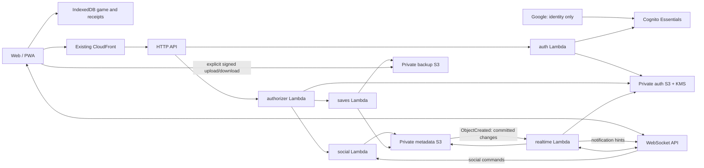

# Web Lambda services

Status: implemented locally, not deployed. This document describes the current
architecture and product boundaries; the [runbook](web-backend-deployment.md) describes
CDK deployment to the single production environment, verification and rollout. The [OpenAPI contract](../packages/web-digital-pet-backend/docs/openapi.json)
defines HTTP request/response models; the [WebSocket JSON Schema](../packages/web-digital-pet-backend/docs/websocket.schema.json)
defines commands, frames, replies and correlated errors. Runtime validators and types live in the shared
`digital-pet-online` package and the web protocol exports.

## Boundaries

There are five Lambda deployment entrypoints, one TypeScript backend, no database
engine and no continuously running server. CDK also creates a deployment-only
helper Lambda to configure S3 notifications; it is not an application service. The local game remains authoritative.
No cloud tick, autosave, creature ownership registry or anti-cheat simulation exists.

Each entrypoint imports its own composition module under `src/runtime/`. Only auth
initializes Cognito and KMS; the authorizer reads sessions through S3 without
constructing auth, social or backup services. Saves initializes only its metadata,
backup storage and game validator. Social and realtime reuse their own warm
delivery/storage clients. HTTP authorization middleware is shared, while routing
and service construction remain separate. Bundle tests check the retained modules.

Offer payloads allow 32 KiB and HTTP JSON bodies allow 40 KiB, preserving valid
256-event partner histories. Socket envelopes retain their smaller limits; large
commands and replies use bounded JSON fragments, assembled before application. Copies retain their separate
4 MiB signed S3 upload limit.

Registration retries stop after three unanswered attempts on one physical socket,
then replace it using exponential reconnect delays capped at 30 seconds. PartySocket resets reconnect backoff only after ten seconds of uptime;
retries use a randomized initial delay and are capped at 30 seconds.
Channel resume also has three attempts; expired/forbidden channel errors identify
the channel and terminate it immediately. Transient errors keep bounded retries.
Unscoped socket errors trigger connection recovery. Healthy idle connections send
no maintenance messages, HTTP polls or heartbeat requests.

If an open response is lost, retrying its original operation ID rebinds the same
channel to the participants' replacement sockets without extending its lifetime.
Both account and installation must still match the original participants; code
reuse cannot transfer a channel to another account. Temporary open failures retain
the pending operation and its bounded retry budget. A disconnected peer can resume
while pending frames retry; a revoked session remains unauthorized. Messages with
no acknowledgement progress for 30 seconds terminate their logical channel and stop
retransmission. Waiting for player consent after delivery creates no such traffic.

Unexpected failures emit a structured `backend-failure` event with operation,
status, optional AWS dependency status and gateway request ID. Client command and
connection IDs are hashed; exception messages, stacks, game data and credentials
are omitted. Each application Lambda has a log metric and application-failure
alarm as well as a Lambda execution-error alarm. This detects caught failures that
produce an HTTP/socket error response without incrementing Lambda's Errors metric.
Only manual backups contain the whole exported game. Trade offers and battle hashes
are the minimal metadata needed for those explicitly requested online operations.

| Function | Responsibility | Permission boundary |
| --- | --- | --- |
| auth | Google callback, opaque session, refresh, logout and socket ticket | Auth prefixes, Cognito app-client secret and KMS encryption/decryption |
| authorizer | Validate the cookie and return trusted account/CSRF context | Read session metadata, never decrypt refresh tokens |
| saves | Reserve, validate, publish, list, download and delete manual backups | Backup catalog and private backup bucket |
| social | HTTP and socket adapters for profiles, relationship decisions, inbox and battle reports | Profile/code/index/relationship/decision metadata, session reads and socket responses |
| realtime | Register endpoints, open/resume logical channels, relay frames and process committed S3 change events | One-use tickets, session checks, live routing, social discovery reads and scoped socket callbacks |

## Layering and transport contract

- Browser feature controllers retain the existing game protocols and persistence
  rules. `OnlineEndpoint` and `OnlineConnection` represent logical channels;
  `OnlineWire` alone owns the physical socket, reconnects and browser lock.
- `online-api` owns authenticated requests; `online-rpc` is an injected transport
  port, avoiding an API/socket import cycle. All social reads and mutations use
  the socket. `partysocket/ws` owns native-WebSocket reconnection with fresh tickets;
  it requires no PartyKit hosting. Its outgoing buffer is disabled. `p-queue` bounds
  RPC concurrency to four, with at most 32 total requests and a 25-second deadline
  including connection/queue wait. Disconnect/account changes cancel outstanding
  work; neither library replays a sent social command. There is no HTTP fallback.
- Backend HTTP and WebSocket adapters authenticate their respective envelopes,
  then call `executeSocial`. This application layer owns validation and dispatch
  to `Accounts`, `SocialService` and `RealtimeService`, independent of HTTP events.
- Domain decisions use the `ObjectStore` port and conditional updates. S3 and
  Gateway Management API clients live in adapters; handlers/runtime compose them.
  Game rules and animations stay in the existing shared/web domain packages.

A socket social request has `{ action: "social", requestId, accountId, command:
{ type, input }, responseChunks: true }`. Replies are `{ kind: "response", requestId, status, body }`.
The actor is derived from the connection's current session on **every command**;
`accountId` is only an expected-identity guard. Commands reuse the HTTP validators
and operation IDs. A request ID correlates a response; it is not an idempotency key.
Each envelope is bounded to 24 KiB. Larger commands replace `command` with
`fragment: { index, total, data }`; the server authenticates every fragment and
assembles up to 48 KiB under `realtime/requests/<connection-hash>/<requestId>`.
Conditional S3 writes admit the complete command once across Lambda instances.
Partial requests expire logically after 60 seconds; the existing one-day realtime
lifecycle removes the objects. Fragments never use an in-memory Lambda queue.
Replies larger than 23 KiB use `kind: "response-part"` and the same fragment shape;
the client accepts out-of-order fragments up to 5 MiB. Gateway sends run in batches
of four. This also covers paginated inbox reads. Old tabs without `responseChunks`
retain their prior HTTP/303 compatibility until reloaded; deploy backend first.
A crash after admission but before domain commit still requires normal recovery
using the existing operation ID, not blind transport replay.
Unknown/invalid commands cannot bypass membership,
quota, destination or consent checks. An ambiguous response is recovered from the
canonical decision and local intent, never by generating a second operation ID.

The socket also carries existing `register`, `open`, `resume`, and `relay` actions.
Notifications contain only `{ kind: "changed", topic: "social" | "battle", eventId }`.
They invalidate local projections; they never apply gifts, trades or battle rewards.
Authentication, manual snapshot controls and direct S3 file transfers stay on
HTTPS. Gameplay, social reads, mutations and notifications use the shared socket.

## Authentication

Google is the sole provider; scopes are exactly `openid email`. Cognito Essentials
supports refresh-token rotation. The browser uses authorization code + PKCE, nonce
and a one-use, browser-bound OAuth state. The backend verifies Cognito signatures,
issuer, audience/client, token use, subject, expiry and nonce before issuing an
opaque `__Host-` HttpOnly, Secure, SameSite=Lax cookie. A successful OAuth
callback revokes the session cookie it replaces, so already-open sockets from
that browser cannot keep issuing commands under the previous account. Provider tokens stay out of
JavaScript, localStorage, game files, URLs and logs. Refresh tokens are encrypted
with KMS using the session digest as encryption context.

Access lasts two hours. The session has a 365-day absolute maximum, subject to
provider revocation and browser cookie retention. Refresh is serialized by a
30-second conditional claim; Cognito's 60-second reuse grace exceeds that claim
and the Lambda timeout so failed publication can retry. Logout durably revokes
the app session first; provider revocation is best effort if Cognito is unavailable.
The authorizer cache is disabled and every relay rechecks both sessions.

Mutating HTTP operations require the exact site Origin and session CSRF header.
`/api/v1/*` also requires the expected account header, preventing a stale tab from
writing through a cookie that now belongs to another account. Public profile codes
and local installation IDs are routing identifiers, never ownership proofs.

## Manual backups and adoption

Existing local progress is adopted explicitly without uploading or replacing it.
The browser stores account, installation and local-save identities separately.
Changing accounts archives old social state and keeps the local game; unresolved
effects must settle first. Legacy public codes cannot claim cloud identities.
An IndexedDB version upgrade preserves the store and prevents version-1 writers
from reopening it. Users reconfirm contacts using their new account codes.

A manual copy reuses the existing version-4 export format. Five copies of at most
4 MiB are allowed by default. Reserve a timestamped operation ID, upload bytes by
a short-lived exact-size S3 POST, then validate SHA-256 and the shared game format
before immutable publication. A two-minute publication lease exceeds the Lambda's
30-second lifetime. Recover a lost completion by inspecting the final object;
retrying the same bytes does not consume another slot. Deletion uses a tombstone
and recovers on later listing. Temporary upload objects expire after one day.

The browser persists upload intent for retry. Restoring requires a downloaded,
validated preview and explicit confirmation; account/save checks run again inside
the IndexedDB transaction. The previous local game is preserved. Intentional
Digimon duplication through user-controlled backups is accepted.

## Social decisions and offline recipients

A sorted pair of account IDs identifies one canonical relationship object.
Conditional S3 updates serialize invitation decisions, friendship removal, gift
claims and exchange commitment. Both participants' bounded discovery indices are
written before publishing a new relationship decision. A partial failure can leave
an empty reference, but cannot acknowledge an undiscoverable decision.

The visible leader tab reconciles on connection/reconnection, foreground/online,
opening a social view and committed-change notifications. There is **no periodic
inbox polling**. Inbox pages contain at most sixteen relationship objects, with a
3 MiB relationship payload budget, plus public profiles and live availability.
The actor's own profile/presence is omitted from those repeated lookups. Notifications are deduplicated and coalesced; a
slow sync gets one pending follow-up rather than one queued read per event. A
known pending operation's deadline schedules one reconciliation; failures get
bounded recovery retries. No sender socket is required to deliver acknowledged
mail. Local outbox intents survive failed sends and offer same-ID retry. Errors
are not delivery acknowledgements. S3 is the durable mailbox, not Lambda memory.

S3 ObjectCreated notifications cover `relationships/`, `profiles/`,
`battle-decisions/` and `realtime/subscribers/`. They invoke realtime after commit,
independently of the sender's response. Processing reads current canonical state,
so duplicate/out-of-order hints are safe. Idempotent no-op changes skip S3 PUTs,
preventing read/ACK notification loops. Subscriber changes notify friends, not the
registering socket itself. Fan-out runs in bounded batches. Failed deliveries to
gone sockets remove the obsolete subscriber. Lambda asynchronous retries handle
transient notification failures; reconciliation on reconnect/view opening recovers
missed hints. This provides eventual recovery, not guaranteed instantaneous push.
Monitor asynchronous failures/dropped events after deployment.

Pending invitations, gifts and trades expire after 14 days. Retry never extends
that lifetime. Terminal records are compacted after 28 days; claimed gifts and
committed exchanges remain recoverable until participants acknowledge local
application. Local application and its receipt share one IndexedDB transaction.
Receipts are scoped to account, installation and save identity.

A renewed friendship generation can start new exchanges while an older committed
exchange awaits its original device. The older decision remains recoverable and
is never undone. Within the same generation, the existing pending-application
guard remains in place. Activity exposes an explicit recovery action when this
account's committed delivery belongs to another installation/save. It recommends
finishing on the original device; confirming abandonment releases only this
account's delivery, preserving the other participant's committed offer. It does
not reconstruct a lost local game. The original save cannot use this action.

Canceled and fully applied exchanges immediately discard their large offer
payloads. Private receipts retain the operation ID, state, offer hash and original
destinations for 28 days, so retries cannot recreate or alter a finished exchange.
Pending and committed-unapplied offers remain available. Receipts never appear in
public inbox projections.

Gifts are limited to one per sender/friend/server UTC day. They can be sent while
the recipient is offline. Collection requires an online claim, then applies the
existing local food eligibility rules. Removing friendship cancels pending gifts
and exchanges. A claim or two-sided commit that already won the conditional update
is a completed decision and remains recoverable; it is not rolled back.

An exchange proposal does not itself confirm consent. Each side explicitly prepares
and locks its local offer, then confirms. The canonical decision commits only when
both sides confirm. Either side can cancel before commit. Recovery never unlocks
another exchange's lock and never applies a decision to a different local save.
The existing exchange transformation, local history and animation remain in use.

## Live battles and device transfer

Authenticated sockets use one-use 60-second tickets, never provider/access tokens
in their URL. Feature endpoints are server-assigned, account/installation-bound,
and live until their connection/session expires, without lease heartbeats. Battle codes have six digits;
device codes have sixteen characters. A channel has a separate unguessable identity,
two pinned members and a 15-minute negotiation lifetime. Resumption changes only the
same account/installation's connection. A browser-wide lock allows one physical
socket per installation; battle and transfer are logical namespaces on it. A
BroadcastChannel forwards invalidations across tabs, not private game payloads.
Social reconciliation follows the shared socket owner; there is no independent
social lock that could elect a different tab and deadlock both features.
Hidden pages release the socket. Local lock acquisition retries do not call AWS.

API Gateway closes idle sockets after ten minutes and any socket after two hours.
Reconnect uses backoff and reconciles durable state; it does not poll the mailbox
while a healthy connection is idle. A one-shot access-expiry deadline renews the session and replaces the socket;
it does not periodically check authentication.
Unacknowledged channel frames can retry every three seconds; with no pending
frames or registration there are zero maintenance messages. Connection loss during
an uncommitted negotiation may require retry; committed effects recover from S3.
[Gateway limits](https://docs.aws.amazon.com/apigateway/latest/developerguide/apigateway-execution-service-websocket-limits-table.html).

The ordered channel buffers bounded out-of-order frames, retransmits unacknowledged
messages and acknowledges after application consumption. Transfers are fragmented
below the API Gateway frame limit and reassembled with bounded memory; the existing
64 KiB transfer validation and sender/receiver consent remain. Close drains the final
messages before releasing channel state. A lost page starts a new negotiation,
while already durable game decisions recover independently of sockets.

Battle clients keep the existing commit/reveal randomness and result calculation.
Before sending readiness they persist a local intent and publish the agreed-plan
hash. One canonical S3 record commits only matching reports from both channel
members and binds their save destinations. Pending reports cancel after 120 seconds.
Committed reports survive live routing expiry. After reload the local intent reads
the decision and enters the existing pending-battle/playback/reward receipt system.
For friend battles, the canonical decision lives in the relationship record so
friend removal and the final report contend on the same conditional write. Removal
cancels pending decisions; it preserves already committed results. A durable routing
record precedes that write and permits recovery if publication of the terminal copy
fails, even after the live channel expires. Unpublished commits are never pruned;
published decisions remain in the relationship beyond all in-flight invocations.
Private battle state is excluded from public inbox responses.
This is agreement recovery, not a server-owned game simulation.

## Bounds and verification

The implementation bounds metadata objects, inbox references, records per pair,
frames, buffered sequences, transfer assemblies and backup size/count. API Gateway
has request throttles. All Lambdas share the account's existing 10 unreserved
concurrent executions, including other functions in that region; there are no
per-function reservations or provisioned instances. Ticket issuance and opening
channels also have per-account windows. Presence is an estimate; a stale code cannot
bypass membership or session checks. Quotas, reconnect overhead and notification fan-out costs require measurement
before scaling. Measure connection minutes, sent/received message units, Lambda
requests/duration, S3 operations and notification fan-out alongside identity,
storage, logging and transfer charges; socket connection time alone is not the
backend cost. The deployment runbook retains the outstanding production verification checks.

Tests cover CAS races and partial writes, identity/CSRF checks, refresh/logout,
canonical cancellation, backup publication/deletion, reconnect binding, reordered
protocol messages and actual browser flows through test HTTP/WebSocket adapters.
Real Google, IAM, S3 CORS/conditional requests, CDN routing, mobile suspend and costs
require verification against the deployed production services. Local validation does not claim to test AWS.

## Friend requests and direct friend battles

A friendship invitation becomes active for both accounts when its recipient
accepts; the sender never confirms it again. Both clients reconcile the canonical
relationship through the existing socket notification/inbox flow.

New friend battles use one realtime `open` command with `namespace: battle`, an
empty `code`, and the authenticated friend's account ID. The server resolves the
friend's most recently registered live endpoint (skipping closed/revoked devices)
and checks the active relationship. The endpoint index is bounded to eight devices,
matching the existing subscription limit. It binds the
channel to the original accounts/installations and friendship generation. The
sender immediately enters the normal battle negotiation; the recipient accepts
once. Closing the sender's waiting dialog cancels that negotiation. Friend channels
expire after two minutes, and relay rejects removed/recreated friendships or a
disconnected participant. No social-mail challenge or periodic polling is created.
Code-based battles retain their existing recipient confirmation. The old social
challenge handler remains compatible with already-open clients; those old notices
expire after two minutes.
