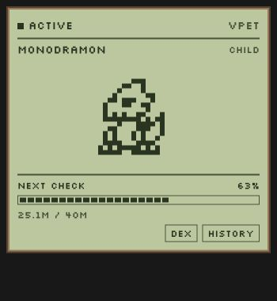
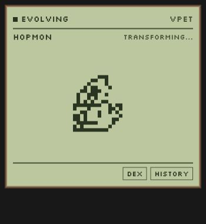
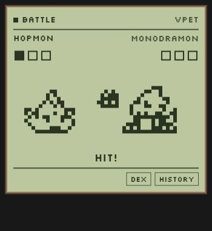
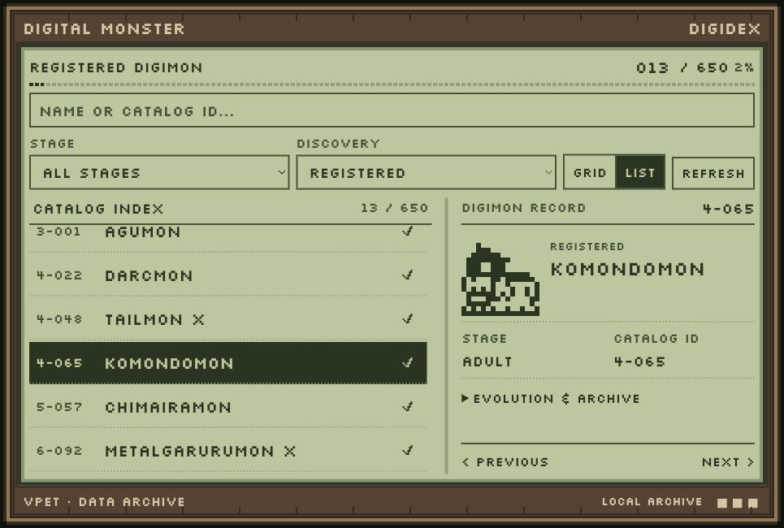

<div align="center">
  
  <h1>Cursor Digital Pet</h1>
  <p>A Digimon companion in your sidebar that evolves as you use Cursor Agent.</p>
  <p>
    <a href="https://open-vsx.org/extension/jcendal/cursor-digital-pet"></a>
    <a href="https://open-vsx.org/extension/jcendal/cursor-digital-pet"></a>
  </p>
</div>

Raise your partner while you work. Discover **650 Digimon**, browse your collection
in the Digidex, and keep previous generations in History. Cursor and OpenCode
Digital Pet share your progress on the same computer.

<div align="center">
  
  
  
</div>

## Installation

Search for **Cursor Digital Pet** in Cursor's Extensions sidebar, or install from
[Open VSX](https://open-vsx.org/extension/jcendal/cursor-digital-pet).

You can also open Quick Open (`Cmd+P` / `Ctrl+P`) and run:

```text
ext install jcendal.cursor-digital-pet
```

For manual installation, download a VSIX from
[GitHub Releases](https://github.com/jcendal/digital-pet/releases) and choose
**Extensions → Install from VSIX…**.

Use Cursor with Node.js 22.13 or newer available on your system. Agent progress tracking requires
Cursor; it is not available in VS Code alone.

## Usage

1. Accept the first-run prompt to install Digital Pet hooks so Agent usage counts
   toward your companion's growth. You can also run **Cursor Digital Pet: Install Hooks**.
2. Open **Digital Pet** in the Explorer sidebar.
3. Open the Command Palette (`Cmd+Shift+P` / `Ctrl+Shift+P`) and run
   **Cursor Digital Pet: Spawn Partner**.

Your partner begins as an egg and gains experience as you complete Agent turns.
Use **Freeze** to pause growth and **Unfreeze** to resume it.

### Care for your partner

Click the egg to earn **1%** toward hatching and see pixel stars. After it hatches,
pet your companion to show hearts and a happy reaction. Petting a sleeping
companion wakes it with bolts and an angry or sad reaction; petting adds no experience.

Piles appear after 2 hours, then another 8 hours later, then 16 hours later.
The timers continue while Cursor is closed. Click each pile to clean it and earn
**5%** of the current evolution requirement. Two or more piles make your companion
sad; cleaning gives it a happy reaction. Cleaning waits during combat or evolution
and are unavailable while frozen.

### Adventures

Use the compass button in the companion viewer to begin an adventure. A new trip
is available every **2 hours**, including time while Cursor is closed.

Collect passing data and food for experience, fight roaming Digimon, and face
regional bosses. Use the pause icon to take a break or the home icon to end the trip.
An adventure also ends after defeat, evolution, or accepting a new companion.

| Find or victory | Experience |
| --- | --- |
| Data or adventure food | 2% |
| Lower-stage rival | 2% |
| Same-stage rival | 5% |
| Higher-stage rival | 15% |
| Regional boss | 50% |

After a victory, the rival has a **15%** chance of offering to become your companion.
Accepting moves your current partner to History and records the new one in your Dex.
Your adventure pauses when the viewer is closed, and you can continue later.

### Digidex and History

Open the Dex to search by name or ID, switch between grid and list layouts, and
filter by stage or companions you have raised. Registered entries show their
artwork and evolution records.

History lets you revisit current and retired generations and their evolution journeys.



## Commands

Open the Command Palette and search for **Cursor Digital Pet**.

| Command | What it does |
| --- | --- |
| **Spawn Partner** | Starts a new egg. |
| **Freeze** | Pauses progression. |
| **Unfreeze** | Resumes progression. |
| **Set Digimon** | Selects a companion by catalog ID, such as `3-001`. |
| **Open Dex** | Opens your collection. |
| **Open History** | Opens current and past generations. |
| **Install Hooks** | Enables Agent usage tracking. |
| **Uninstall Hooks** | Removes Digital Pet hooks. |

**Set Digimon** does not count toward Dex completion.

## Settings

Open Cursor Settings and search for `digital-pet`.

| Setting | Default | Purpose |
| --- | --- | --- |
| `databasePath` | Shared save location | Choose a different companion save file. Reload Cursor after changing it. |
| `usage.settleDelayMs` | `4000` | Wait before checking usage if Agent does not report it immediately. |

The interface follows Cursor's language and supports English, Korean, Spanish,
and Galician. Digimon use Japanese names by default. Cursor does not read
OpenCode's naming or evolution settings.

## Storage

Your companion, Dex, and History are saved in the same `pet.db` file as OpenCode
Digital Pet. Back up this file to keep a copy of your progress.

| Platform | Save file |
| --- | --- |
| macOS | `~/Library/Application Support/opencode-digital-pet/pet.db` |
| Linux / WSL | `~/.local/share/opencode-digital-pet/pet.db` |
| Windows | `%APPDATA%\opencode-digital-pet\pet.db` |

An existing `opencode-vpet/pet.db` remains in use if the new save does not exist.
Use `digital-pet.databasePath` to choose a custom file.

## Privacy and help

Companion data stays on your computer. The extension has no analytics or telemetry.
If Agent does not report usage directly, Digital Pet checks your Cursor usage
through your signed-in account.

| Problem | Try this |
| --- | --- |
| Agent turns do not give experience | Run **Install Hooks** and retry. |
| Usage arrives late | Increase `digital-pet.usage.settleDelayMs`, for example to `8000`. |
| A new save path is not applied | Reload the Cursor window. |

Report problems in [GitHub Issues](https://github.com/jcendal/digital-pet/issues).
For development, see [CONTRIBUTING.md](https://github.com/jcendal/digital-pet/blob/main/CONTRIBUTING.md).

## Credits and license

Maintained by [Jorge Cendal](https://github.com/jcendal), with
[Sergio Bugallo](https://github.com/sbugallo) as original author and contributor.

Licensed under [Apache 2.0](LICENSE). Sprite credits are in the
[root README](https://github.com/jcendal/digital-pet#maintainer-and-credits).
