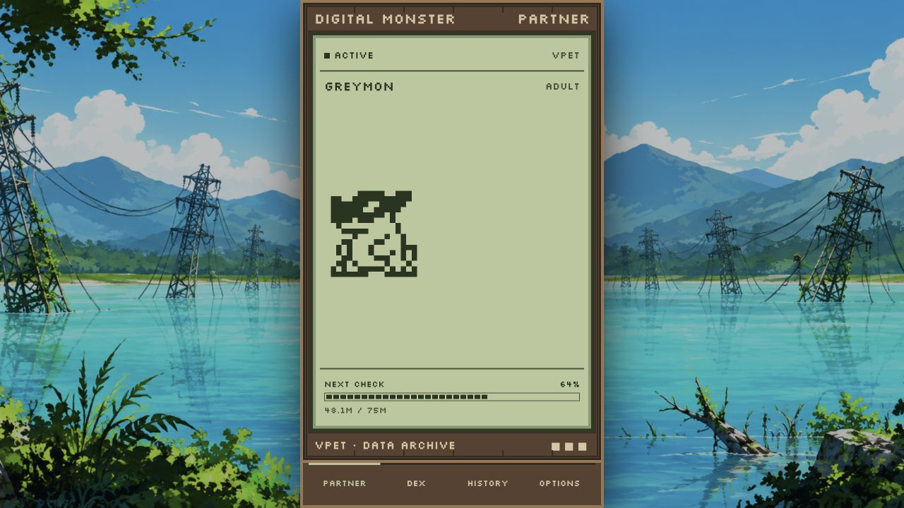
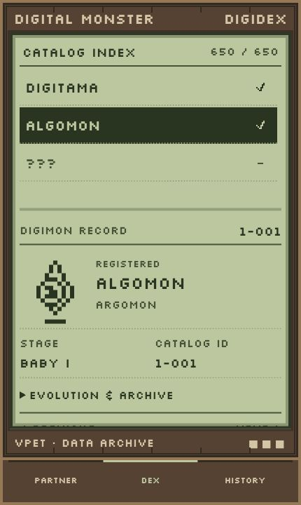
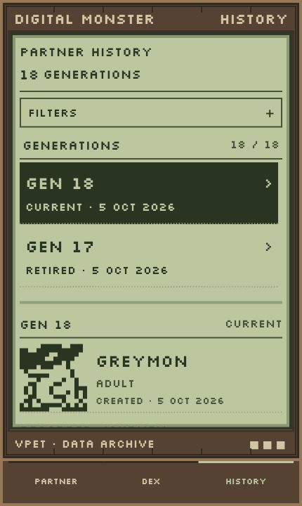
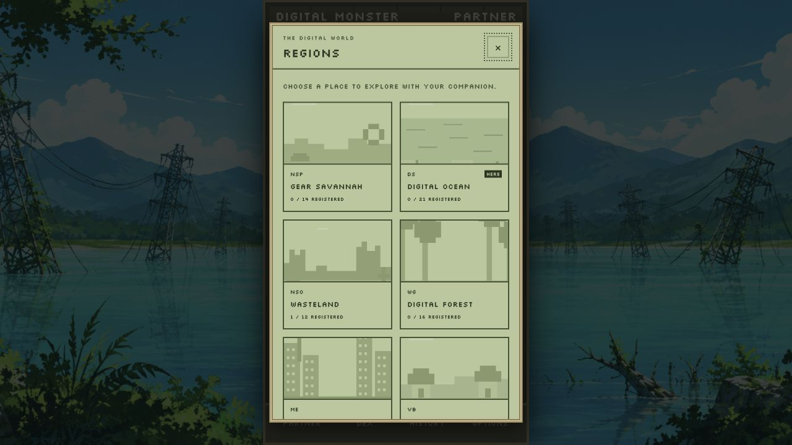
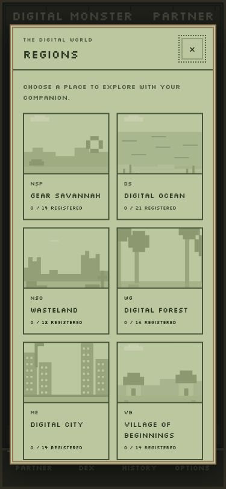
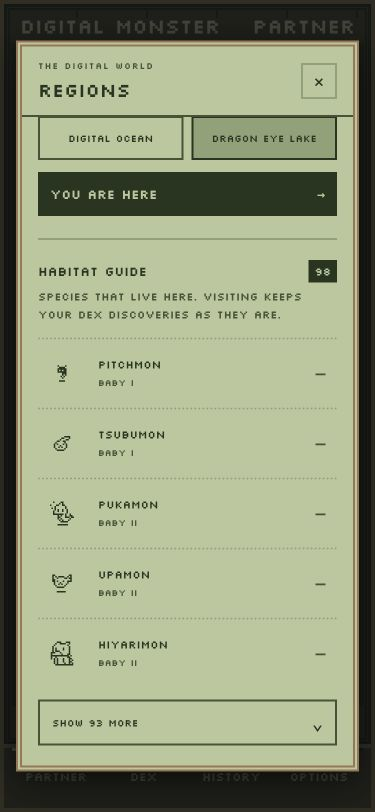
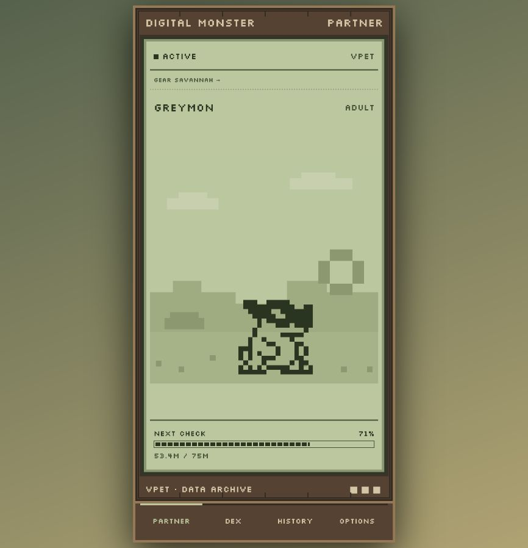
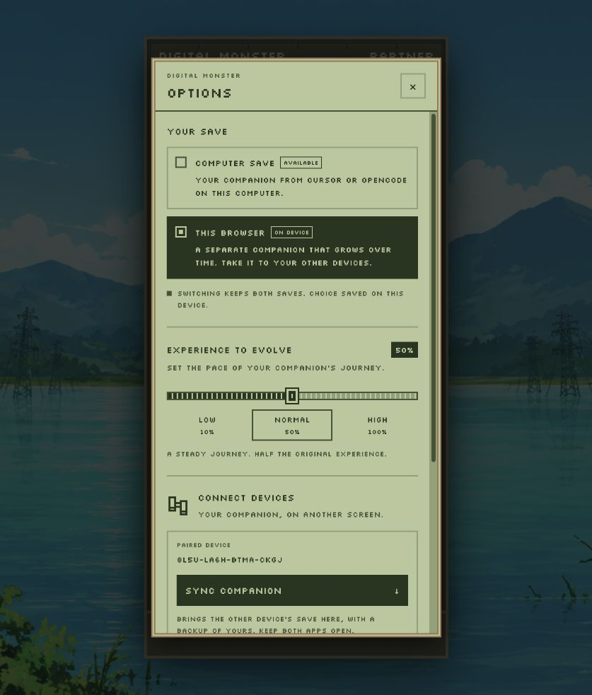
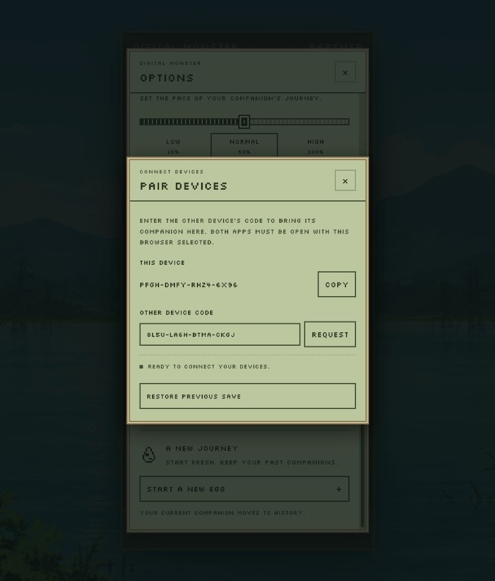
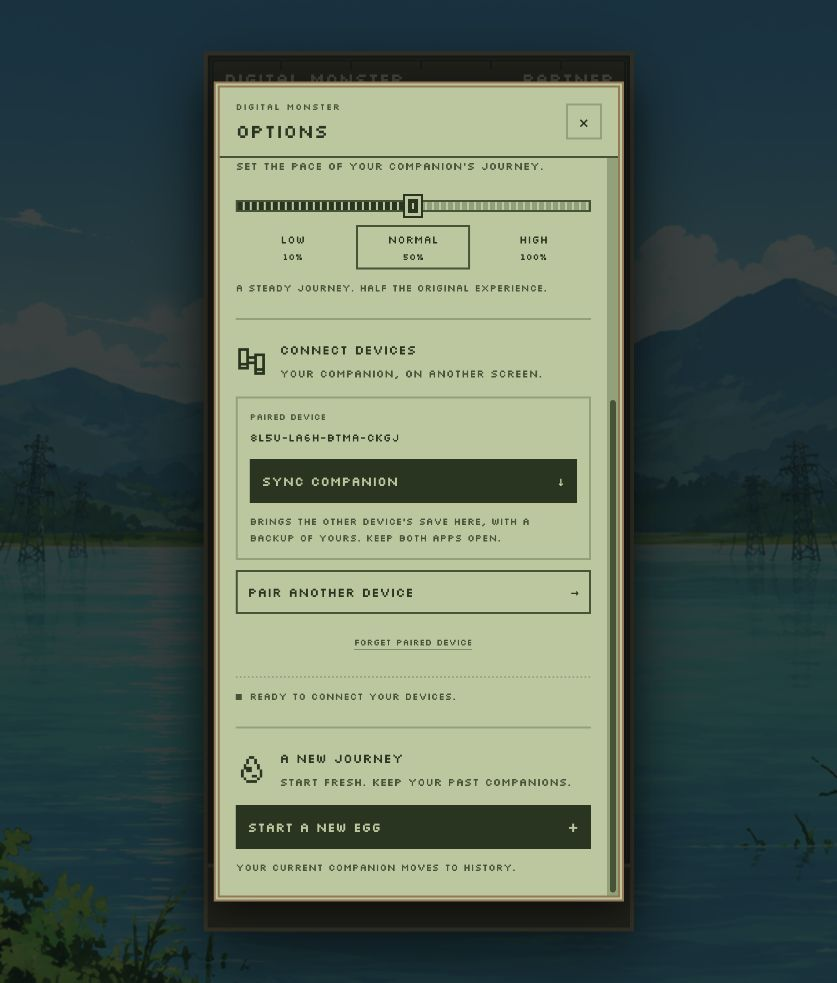

<div align="center">
  
  <h1>Web Digital Pet</h1>
  <p>Raise a Digimon, explore the Digital World, and challenge your friends.</p>
</div>

Hatch an egg and grow your own browser companion, or view the partner you raised
with Cursor or OpenCode on your computer. Discover **650 Digimon**, keep your
collection in the Digidex, and revisit past generations in History.

<div align="center">
  
  <p>
    
    
  </p>
</div>

The screenshots show an example computer save. A new browser companion starts
as an egg.

## Quick start

To run the app on your computer, install **Node.js 24.11.0 or newer**, then run
these commands from this repository:

```sh
npm ci
npm run web
```

Open [http://localhost:4173](http://localhost:4173). In **Options → Your Save**,
choose **This Browser** to raise a new companion or **Computer Save** to view your
Cursor/OpenCode partner.

Your phone's `localhost` is not your computer. Access from another device requires
a hosted copy of the app.

## Care and growth

Browser companions gain **2%** of their evolution requirement every **2 hours**.
Time while the app is closed counts too. Evolutions play when you return to the
companion viewer.

| Action | What happens |
| --- | --- |
| Tap the egg | Pixel stars and 1% toward hatching. |
| Pet your companion | Hearts and a happy reaction. A sleeping companion wakes with bolts and an angry or sad reaction. |
| Collect food | Food appears after one hour; tap it for 5% experience. |
| Clean a pile | Tap it for 5% experience and a happy reaction. Two or more piles make your companion sad. |

Piles appear 2 hours after hatching, then another 8 hours later, then 16 hours later.
Food and hygiene timers continue while the app is closed. Eggs have no food or
piles. Care actions wait during battles and evolution.

## Adventures

Use the compass button in the companion viewer to start an adventure. A new trip
is available every **2 hours** for each Digimon independently. Both companions'
adventure waits continue in reserve and while the app is closed. Only apple and
care timers pause in reserve; switching does not copy one companion's cooldown
to the other.

Tap passing data and food to collect experience, fight roaming Digimon, and watch
for regional bosses. Use the pause icon to take a break or the home icon to return.
A trip also ends after defeat, evolution, or accepting a new companion. Closing
the viewer pauses the adventure so you can continue later.

| Find or victory | Experience |
| --- | --- |
| Data or adventure food | 2% |
| Lower-stage rival | 2% |
| Same-stage rival | 5% |
| Higher-stage rival | 15% |
| Regional boss | 50% |

Rewards arrive after the battle finishes. A defeated rival has a **15%** chance
of offering to become your new companion. Accepting keeps your previous partner
in History and registers the new one in the Dex.

Bosses have a special introduction. Defeat one to earn a star on its region's
map card; these achievements remain when you start a new companion.

## Explore the Digital World

Open **Map** in the bottom navigation, or select the location name above your
companion. Touch a region on the pixel island, then choose a location to travel there;
the location name appears above the map. All twenty places are available, including
**Dragon Eye Lake**, where your journey begins. Travel works offline and remembers
your destination. A small star marks regions where you have defeated a boss.

For the habitat guide, open **Map → Regions**. Browse the ten regions,
inspect their inhabitants, and choose **Travel Here**.

Each place has its own pixel landscape. The habitat guide marks Digimon you have
raised; visiting a region does not unlock its inhabitants in the Dex. Use the arrow
below the first five cards to see more.

<div align="center">
  
  <p>
    
    
  </p>
  
</div>

## Player battles

Both players must have the app open and online with **This Browser** selected.

1. Open **Battle** in the bottom navigation.
2. Share your six-digit code, or enter the other player's code and choose **Challenge**.
3. The other player chooses **Accept Battle**.

The invitation panel closes and both players watch the battle in their companion
viewers. Eggs and companions waiting to evolve cannot enter a player battle.

A win against the same stage gives **20%** experience. Each lower rival stage
halves the reward, and each higher stage doubles it. Draws give no experience,
and losing has no penalty. Experience is added after the animation finishes,
up to the amount needed for the next evolution.

Keep both apps connected until the battle begins. Once saved, an interrupted
battle can continue when you return or reload. Battle codes change when you reload.

## Options

Open **More ···** in the bottom navigation for **Options**. Open **Dex** for the
**Dex** and **History** tabs, which keep your catalog filters and generation
selection while you switch between them.

Choose your language, travel to another region, adjust growth speed, or start a
new egg. Starting over keeps your previous companion in History.

<div align="center">
  
</div>

| Evolution experience | Effect |
| --- | --- |
| Low | Requires 10% of the original experience for faster evolution. |
| Normal | Requires 50% of the original experience. |
| High | Uses the original experience requirement. |

The interface supports **English, Korean, Spanish, and Galician**. Your first visit
uses your browser's language; **Options → Language** remembers your own choice.

**Moving Landscape** controls the scrolling scenery. **Music** switches the
8-bit soundtrack on or off: *Butter-Fly* in the world and *Brave Heart* in battles.
Music starts with your first interaction and also works offline. Safari may pause
briefly between repetitions. See the [soundtrack credits](assets/music/README.md).

## Your saves

| | Computer Save | This Browser |
| --- | --- | --- |
| Companion | Shared with Cursor and OpenCode on this computer. | A separate partner raised in the browser. |
| Growth | Managed in Cursor or OpenCode. | Time, care, adventures, and player battles. |
| Available offline | Needs the local server to show updated progress. | Available after the first completed load. |
| Transfer to another device | Not available here. | Pair devices or use Sync. |

Switching saves preserves both companions. Browser progress stays in this browser
on this site; another browser or address has a separate save. Clearing site data
removes it. Transfer a copy to another device if you want to keep a backup.

## Transfer a browser save

Keep both devices **open and online** with **This Browser** selected.

<div align="center">
  
</div>

1. On device B, open **Options → Pair Devices** and copy its code.
2. On device A, enter B's code and select **Request**.
3. On B, choose **Send Save & Pair** to approve.
4. On A, review the preview and choose **Replace Save & Pair** or **Keep Mine**.
5. Use **Restore Previous Save** on A if you want to undo the import.

Both devices then remember each other. Choose **Sync** to bring the paired device's
current save here again; the other app must remain open. **Forget Device** removes
the pairing.

<div align="center">
  
</div>

Sync replaces the receiving save and keeps a backup. It does not merge progress
or run automatically; each device can continue growing separately afterward.

## Install the app

1. Open Digital Pet and let the first load finish.
2. Choose **Install app** when your browser offers it. In Safari, use the browser's
   Share menu and choose **Add to Home Screen**.
3. Launch the app from its new icon.

Browser saves and music work offline. Player battles and device transfers need
an internet connection.

## Privacy and help

No account, analytics, or automatic cloud backup is required. Saves stay on your
device. Approved battles and transfers use PeerJS to connect the two players or devices.

Report problems or suggest features in [GitHub Issues](https://github.com/jcendal/digital-pet/issues).
For development setup, see [CONTRIBUTING.md](../../CONTRIBUTING.md).

## Credits and license

Maintained by [Jorge Cendal](https://github.com/jcendal), with
[Sergio Bugallo](https://github.com/sbugallo) as original author and contributor.

Licensed under [Apache 2.0](../../LICENSE). Sprite credits are in the
[root README](../../README.md#maintainer-and-credits).
