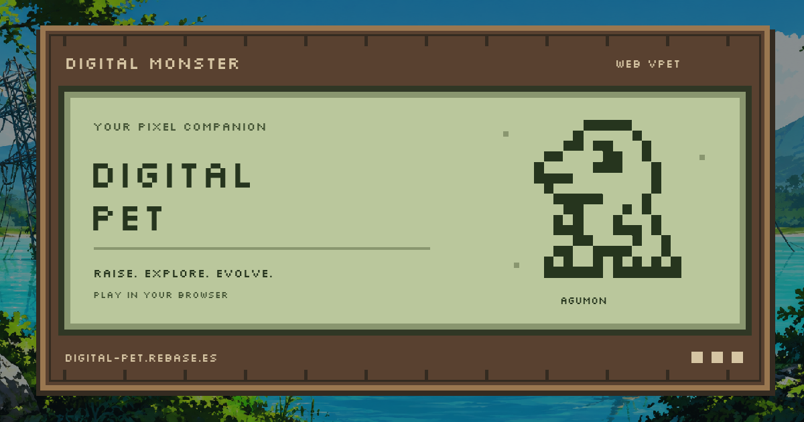

# Link previews and installation presentation

The public origin is `https://digital-pet.rebase.es/`, matching
`infra/web-digital-pet.yml`. The source for the generated `index.html` is
`src/server/rendering/pages.ts`; do not edit generated build output.

`social-metadata.ts` adds title, description, canonical URL, Open Graph and large
image card metadata directly to the shell head. Crawlers receive them without
running JavaScript. The 1200×630 PNG is part of the hashed resource inventory, and
its metadata uses an absolute HTTPS URL. Generic page metadata does not include
player aliases, pairing codes or invitation fragments.

Regenerate it with `python3 scripts/build-web-social-card.py` from the repository
root. It reuses the existing font, icon and lake background; no remote artwork is
needed. Product copy stays in the web package's four translation catalogs. The
initial public static HTML uses the existing default English locale; a crawler
does not run the browser's later language selection.

The web manifest retains its existing app ID, start URL, scope and installation
icons. It now includes a more complete description, language/direction, narrow and
wide screenshots, and shortcuts to the companion and Digidex. Both development
and static export remap every icon, screenshot and shortcut icon through the same
resource inventory. JPEG resources have the correct server MIME type.

Build and deploy the web package before testing the public URL in messaging apps.
Messaging services may cache previous previews; deployment does not force an
already posted message to update. Rendering checks confirm the HTML and image,
not the appearance or cache state of a particular WhatsApp client.

References: [Open Graph metadata](https://ogp.me/),
[Web Application Manifest](https://www.w3.org/TR/appmanifest/).

## Invitations

The web app copies an invitation using its root URL with a fragment:
`https://digital-pet.rebase.es/#invite?code=K7MD9QXR4NWA6TBY&alias=jcendal`.
This uses the existing root route and needs no new server route or personalized
crawler endpoint. The generic Open Graph card is shared; the browser reads and
validates the invitation after load. A fragment is not sent with the HTTP request.

Opening never sends a request automatically. Show the supplied alias as an
unverified link label and the exact code, reject malformed/self/duplicate targets,
and require authentication, a profile alias and explicit confirmation before
sending. Resolve the actual profile through the authenticated social service.

A failed send retains a local outbox intent and stable operation ID for retry.
Only the backend's durable relationship decision acknowledges delivery; an error
or timeout is not an acknowledgement. The recipient can be offline when the
request is accepted by the backend. Pending invitations expire after 14 days and
are discovered on connection/reconnection, opening the social view and change
notifications, without periodic inbox polling.

See [Social decisions and offline recipients](../../../docs/web-backend-service-design.md#social-decisions-and-offline-recipients)
for current identity, storage and recovery behavior. The isolated design prototype
uses its own fixture outbox and does not access real saves.
